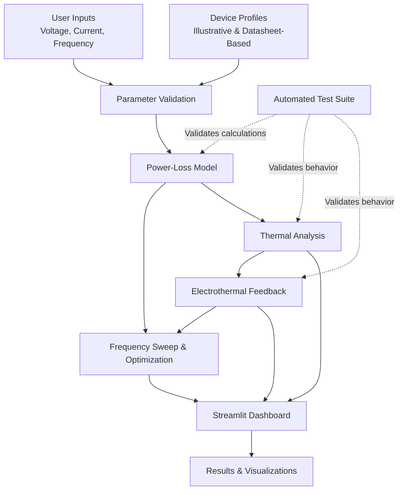

# GaN Power Electronics Simulator — Architecture

## Architecture Overview

- **Inputs:** User-selected operating conditions and device parameters.
- **Device profiles:** Illustrative semiconductor parameters and the GS66508B datasheet-based profile.
- **Simulation engine:** Calculates losses and evaluates frequency and thermal behavior.
- **Electrothermal feedback:** Models interactions between electrical losses and device temperature.
- **Dashboard:** Presents model outputs and comparisons interactively.
- **Automated tests:** Check calculations, validation, and expected model behavior.
